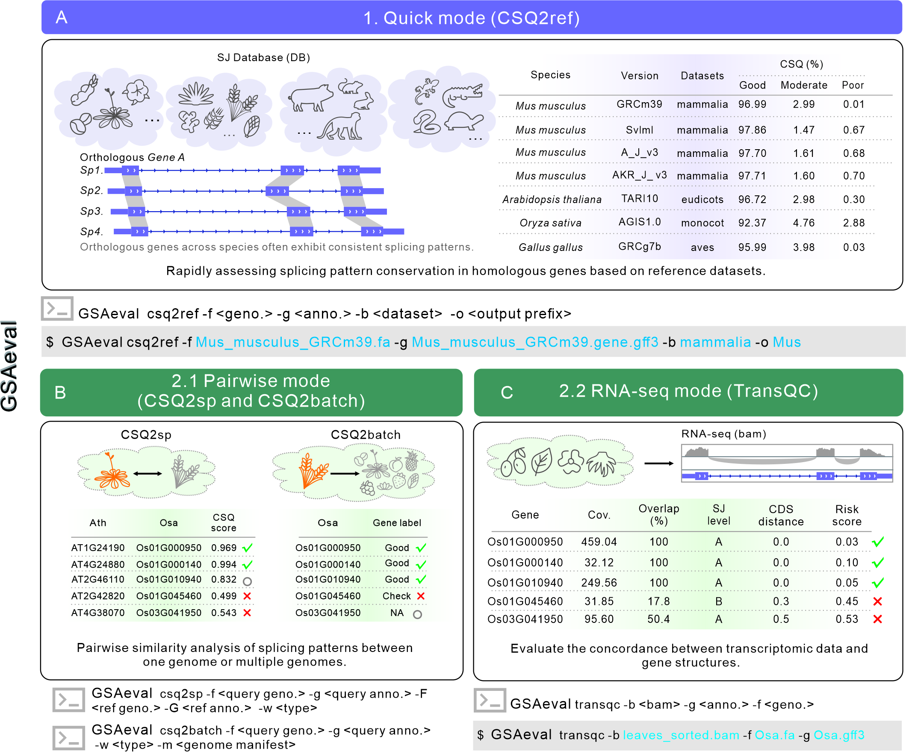

## <font style="color:rgb(0, 0, 0);"> Instructions </font>
**<font style="color:rgb(0, 0, 0);">GSAeval comprises three core analysis modes:</font>**

<font style="color:rgb(0, 0, 0);">1) CSQ2ref: Quick Detection Mode; </font>

<font style="color:rgb(0, 0, 0);">2) CSQ2sp and  CSQ2batch: Inter-Species Gene Comparison Mode; </font>

<font style="color:rgb(0, 0, 0);">3) TransQC: Transcript-Level Evaluation Mode. </font>

<font style="color:rgb(0, 0, 0);">The CSQ2ref mode is designed for quick screening of annotation quality, while the CSQ2sp/CSQ2batch and TransQC modes focus on comprehensive assessments at the gene level.</font>

<font style="color:rgb(0, 0, 0);"></font>
**** 

<a href="images/Fig.7v8.jpg">
  
</a>


## <font style="color:rgb(0, 0, 0);"> Installation </font>
### github
```shell
#Install Dependencies
conda  create -n GSAeval -c conda-forge  python=3.10.5 
conda activate GSAeval

conda  install  -c bioconda  stringtie  mash  regtools gffread bedtools
```

```shell
# Download code and the datasets tracked with Git LFS
# Install Git LFS first: https://git-lfs.com/
git lfs install
git clone  https://github.com/Mavis-Mai/GSAeval.git

cd GSAeval
git lfs pull
chmod +x GSAeval
chmod +x script/diamond
export PATH="$PWD:$PATH"
pip install -r requirements.txt

# download database
wget https://github.com/Mavis-Mai/GSAeval/releases/download/genome_v1/Genome_lib.tar.gz
tar -xzf Genome_lib.tar.gz

GSAeval --help
```

### singularity
```
cd GSAeval
dirpath=`pwd`

alias GSAeval="singularity exec  \
--bind $dirpath/Genome_lib/:/opt/GSAeval/Genome_lib:ro  \
--bind  $dirpath/Dataset/:/opt/GSAeval/Database:ro \
 $dirpath/GSAeval-2026_10_31.sif   GSAeval"

GSAeval --help
```


## <font style="color:rgb(0, 0, 0);"> 01. CSQ2ref mode </font>
This mode is specifically designed for the rapid evaluation of splice site accuracy in gene annotations. Users are required to select a suitable reference splice site database based on the species category. By comparing the splicing characteristics of target species genes with homologous genes in the reference database, the system generates a composite evaluation metric called CSQ (Conservative Splice Quality) score. Based on the CSQ score distribution, the system accurately classifies annotated genes into three confidence levels: Good, Moderate, and Poor. Notably, the proportion of genes classified as "Good" can directly reflect the overall accuracy of splice site identification in the genome annotation of a given species, providing researchers with an intuitive quality assessment reference.
**** 

## Database：
| Database name | Type | Gene number |
| :---: | :---: | :---: |
| eudicots | plant | 1,699 |
| monocot | plant | 1,753 |
| embryophyta | plant | 1,205 |
| sauropsida | animal | 3,920 |
| mammalia | animal | 8,086 |
| aves | animal | 3,649 |
| vertebrata | animal | 2,443 |

### Quick Start Guide</font>
1. When no specific database is specified, the program will automatically select a suitable database for analysis
```bash
GSAeval csq2ref -f  Arabidopsis_thaliana.genome.fna -g Arabidopsis_thaliana.genome.gff3 -l full_table.tsv  -b eudicots
```

2. If the BUSCO (odb12 version) alignment results are available, the program will automatically select the corresponding library for comparison
```bash
GSAeval csq2ref -f  Arabidopsis_thaliana.genome.fna -g Arabidopsis_thaliana.genome.gff3 -l full_table.tsv
```

3. If you want to specify a specific database for comparison
```bash
GSAeval csq2ref -f  Arabidopsis_thaliana.genome.fna -g Arabidopsis_thaliana.genome.gff3 -b eudicots
```

### Parameter Description
| Parameter | Description |
| :---: | :---: |
| -f/--fasta | Input the genome file of the target species[fasta]**<****<font style="color:rgb(0, 0, 0);">Required</font>****>** |
| -g/--gtf | Input the genome annotation file of the target species[gff/gtf]**<****<font style="color:rgb(0, 0, 0);">Required</font>****>** |
| -b/--library | Input the name of the corresponding reference database **<****<font style="color:rgb(0, 0, 0);">Required</font>****>** |
| --showdb | Display the information of the built-in optional reference libraries. |
| -o/-output | Output prefix, default: output. <optional> |
| -l/--busco-table | <font style="color:rgb(0, 0, 0);">Input homologous gene mapping table for the detected species in BUSCO </font>[full_table.tsv]<optional> |
| --max-target-seqs | <font style="color:rgb(0, 0, 0);">When a predefined gene family mapping table is not provided, the system will automatically invoke the DIAMOND alignment program to perform homologous gene sequence alignment. This parameter sets the number of optimal match relationships, default: 2 </font><optional> |
| -d/--type | The features for CSQ analysis are calculated using CDS or exon, default: CDS <optional> |

### Results Description
| Result files | Description |
| :---: | :---: |
| output_busco.csq.tsv | Data statistics of splicing information for homologous gene mapping relationships. |
| output_busco_max_CSQ.txt | Select the homologous gene with the highest CSQ score in the mapping relationship. |
| output_busco_label_CSQ.txt | Classify target species genes based on CSQ annotations of homologous genes. |
| output_busco_pie.png/output_busco_pie.svg | Pie chart of target species gene classification. |
| output_busco_pie.stat | Statistical information on target species gene classification. |
| Missing_busco.id | Gene ID information from the database is missing in the annotation of the target genome. |

output_busco_pie.png：
<a href="images/Figure1v8.jpg">
  
</a>

## <font style="color:rgb(0, 0, 0);"> 02. CSQ2sp mode (One-to-One) </font>
This mode analyzes homologous genes between two species by evaluating the CSQ score distribution, enabling detailed and comprehensive similarity analysis for each homologous gene.
**** 

### Quick Start Guide：
```bash
GSAeval csq2sp -f Oryza_sativa_NIP.genomic.fa -g Oryza_sativa_NIP.genomic.gff -F Arabidopsis_thaliana.genome.fna -G Arabidopsis_thaliana.genome.gff3 
-w plant 
```

### Parameter Description：
| Parameter  | Description |
| --- | --- |
| -f/--query_fasta | <font style="color:rgb(0, 0, 0);">Input the genome file of the detected species [FASTA]**<****<font style="color:rgb(0, 0, 0);">Required</font>****>**  |
| -g/--query_gtf | Input the genome annotation file of the detected species [gff/gtf]**<****<font style="color:rgb(0, 0, 0);">Required</font>****>** |
| -F/--ref_fasta | <font style="color:rgb(0, 0, 0);">Input the genome file of the reference species </font>[fasta]**<****<font style="color:rgb(0, 0, 0);">Required</font>****>** |
| -G/--ref_gtf | Input the genome annotation file of the reference species [gff/gtf]**<****<font style="color:rgb(0, 0, 0);">Required</font>****>** |
| -w/--weight_type | Select the weight for CSQ calculation as either "plant" or "animal" based on the input species type **<****<font style="color:rgb(0, 0, 0);">Required</font>****>** |
| -o/-output | <font style="color:rgb(0, 0, 0);">Output prefix (default: output) <Optional ></font> |
| -l/--genepairs | Input the homologous gene mapping table for two species <Optional><br/>If this parameter is missing, the system will default to using Diamond to perform reciprocal matching of the genes from the two species to generate the gene mapping table. |
| -k/--max-target-seqs | <font style="color:rgb(0, 0, 0);">This parameter sets the number of optimal matching relationships (default: 2) <Optional>.</font> |
| -d/--type | The feature used for CSQ analysis is calculated based on CDS or exon (default: CDS) <Optional>. |
| -t/--threads | The number of threads used for alignment (default: 8) <Optional>. |
| --fig_format | Output image format, such as svg, png, or pdf. Default: svg <Optional>. |

### Results Description：
| Result files | Description |
| :---: | :---: |
| output.csq.tsv | Splicing information statistics of homologous gene mapping relationships |
| reciprocal_pairs.tsv | Reciprocal gene pairs of homologous genes|
| CSQ-density.png/CSQ-density.svg | Distribution of CSQ in homologous genes.|

## <font style="color:rgb(0, 0, 0);"> 03. CSQ2batch mode (One-to-Many) </font>
This mode evaluates the CSQ score distributions of homologous genes between the target species and multiple reference genomes, providing a more comprehensive assessment of the target specie genes.
**** 

### Start Guide
1. If the user does not provide reference genome information, the program will automatically use 20 built-in high-quality genome annotations for comparison.
```
GSAeval csq2batch -f Oryza_sativa_NIP.genomic.fa -g Oryza_sativa_NIP.genomic.gff -w plant 
```

2. The program supports user-defined reference genome directories using a `species_manifest.tsv` file. The file format is as follows:

| species | fasta |gtf|genepairs (option)|
| :---: | :---: | :---: | :---: |
| Nymphaea colorata | Ncolorata_566_v1.0.fa.gz |Ncolorata_566_v1.2.gene.gff3||
| Arabidopsis thaliana | GCA_978657495.1_TAIR12_genomic_clean.fna|GCA_978657495.1_TAIR12_genomic.gff||
| Glycine max | Gmax_275_v2.0.fa.gz|Gmax_275_Wm82.a2.v1.gene.gff3||

*Note: The genome files and annotation files must be placed in the same directory as the `species_manifest.tsv` file.*

```
GSAeval csq2batch -f Oryza_sativa_NIP.genomic.fa -g Oryza_sativa_NIP.genomic.gff -w plant -m species_manifest.tsv
```
### Parameter Description：
| Parameter  | Description |
| --- | --- |
| -f/--query_fasta | Input the genome file of the detected species [FASTA] **<****<font style="color:rgb(0, 0, 0);">Required</font>****>**  |
| -g/--query_gtf | Input the genome annotation file of the detected species [gff/gtf]**<****<font style="color:rgb(0, 0, 0);">Required</font>****>** |
| -w/--weight_type | Select the weight for CSQ calculation as either "plant" or "animal" based on the input species type **<****<font style="color:rgb(0, 0, 0);">Required</font>****>** |
| -m |  <font style="color:rgb(0, 0, 0);">Table mapping genome files and annotations for reference species <Optional></font>|
| -o/-output | <font style="color:rgb(0, 0, 0);">Output prefix (default: output) <Optional ></font> |
| --excusion-species | Exclude specific species from the reference table <Optional> |
| --reuse | Reuse existing alignment data without rerunning <Optional> |
| -t/--threads | The number of threads used for alignment (default: 8) <Optional>. |

### Results Description：
| Result files | Description |
| :---: | :---: |
| pairwise | Records homologous gene mapping relationships and corresponding CSQ information |
| CSQ_summary.tsv | Summary of CSQ data for target species genes and their homologous genes in reference species|
| gene_assessment.tsv | Classification of target species genes based on CSQ distributions|
|gene_locus_classify.tsv| Evaluation and classification of gene loci|
|gene_locus_proportions.tsv| Statistical table of gene locus classifications|
|gene_locus_proportions.png|Pie chart visualization of gene locus classification stats|
|generank.png|Ranking chart of CSQ distributions for genes, illustrating their distribution|


## <font style="color:rgb(0, 0, 0);"> 04. TransQC mode </font>
This model comprehensively evaluates and analyzes the splicing status of each expressed gene by incorporating user-supplied transcriptome data into the annotation of the target genome.
**** 


### Quick Start Guide
```bash
GSAeval transqc -f  Arabidopsis_thaliana.genome.fna -g Arabidopsis_thaliana.genome.gff3 -b bamfile/ -t 10
```
### Parameter Description：
| Parameter | Description |
| :---: | :---: |
| -g/--gtf | Input the genome annotation file of the detected species [gff/gtf] **<Required>** |
| -b/--bam_floder_file | Input the directory containing transcriptome files or the transcriptome files themselves **<Required>** |
| -f/--fasta | <font style="color:rgb(0, 0, 0);">Input the genome file of the detected species [</font>fasta]<Optional> |
| -o/-output | <font style="color:rgb(0, 0, 0);">Output prefix (default: output)</font> <Optional> |
| --force | Force regenerate all results. |
| -m/--min_overlap | Minimum overlap ratio between transcriptome-predicted loci and detected species loci (Default 0.5) |
| -c/--min_support | Minimum threshold for the number of reads supported by the transcriptome (Default 5) |
| -t/--threads | Number of running threads (Default 8) |
| -r/--recordTyep | Extraction of splice sites based on exon/CDS features (Default: exon) |
| --item | Extract exon information items. |
| --idItem | Extract transcript gene items. |

### Results description：
| result files | description |
| :---: | :---: |
| Quality_info | Store files and result images generated during the execution process. |
| Gene_Region | Store files and result images related to gene locus overlaps. |
| Splice_junctions | Store files and result images related to splice site matching. |
| **Total_gene_quality.tsv** | **Detailed table for overall gene quality assessment.** |


